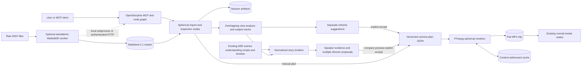

# Insta360 extension architecture

Status: Phase 6 distributed worker and operational hardening implemented, 2026-07-25.

## Purpose and boundaries

The extension turns either a stitched 2:1 equirectangular master or, through an
optional external worker, raw Insta360 footage into ordinary flat clips. Those
clips re-enter OpenStoryline's existing media, understanding, timeline, and
rendering workflow. Ordinary media never passes through spherical code.

Stitching and reframing are separate operations. The deterministic FFmpeg path
must work with a Studio-exported master before any proprietary SDK or automatic
camera direction is enabled.

## Data flow

1. A dedicated spherical import node probes an already stitched master. It does
   not change `load_media` or ask normal video nodes to decode `.insv`.
2. The node stores a compact `SphericalAsset` reference in the current session
   and generates a proxy when requested.
3. Inspection produces metadata and review artifacts. Optional Phase 4 analysis
   produces versioned detections and subject tracks from overlapping views.
   Assisted camera tracks remain separate suggestions until explicit acceptance;
   a human or agent may also create a manual `VirtualCameraTrack` directly.
   Accepted/manual create, update, and delete operations are immutable events in
   the existing `ArtifactStore`; reconstruction rejects discontinuous revisions.
4. Phase 5 maps existing ASR, scene, clip-understanding, script, and timeline
   results onto the same source clock. Speaker-candidate scoring retains weak
   evidence and alternatives. The virtual director creates multiple scored
   proposals; only explicit acceptance creates a director camera-track event.
5. The spherical renderer validates paths and contracts, probes FFmpeg
   capabilities, renders to a temporary output, validates it, atomically moves
   it into place, and writes a `ReframeRenderManifest`.
6. The session interceptor excludes imported spherical masters from generic
   media discovery and adds only completed flat renders to the existing
   `load_media` workflow.
7. For raw ingest, the Python client first checks standalone-worker
   capabilities, sends explicit ordered `.insv` paths, validates the returned
   identities and hashes, ffprobes the 2:1 output, and imports only that master.
   The checked-in stub fails closed, so this path becomes usable only on an
   approved private SDK host.

## Existing extension-point audit

| Concern | Current implementation | Selected attachment point |
| --- | --- | --- |
| Base node | `BaseNode` owns client media packing, input persistence, output packing, output directories, and the `process`/`default_process` lifecycle. | Future spherical tools subclass `BaseNode`; shared renderer logic stays in `open_storyline.spherical`. |
| Metadata and schemas | `NodeMeta` declares tool name, description, ID, kind, prerequisites, next nodes, and priority. Inputs are Pydantic models assigned to `input_schema`. | Define spherical node inputs alongside established Pydantic schemas or in a focused spherical schema module, then expose them through `input_schema`. |
| Discovery and registration | `NODE_REGISTRY.scan_package` imports packages; decorators register classes. `config.toml` allowlists packages and class names. | Add nodes to the existing package scan and allowlist only when the feature reaches Phase 2. No second registry. |
| MCP tools | `register_tools.register` turns each configured node into a FastMCP tool and carries `NodeMeta` into tool metadata. | Use the existing wrapper and JSON-schema generation. Do not hand-register duplicate spherical tools. |
| Dependency graph | `NodeManager` and `ToolInterceptor` resolve `node_kind` prerequisites and retrieve the latest session artifact. | Give spherical import/plan/render nodes distinct kinds and explicit prerequisites. |
| Artifact storage | `ArtifactStore` writes per-node JSON plus `meta.json` under `outputs/<session_id>`; `BaseNode` uses `.storyline/.server_cache/<session>/<artifact>`. | Persist compact spherical records and review artifacts through these stores; keep cache records separate from session history. |
| Session and artifact IDs | The request header supplies the session ID. Artifact IDs are generated from node ID plus a timestamp and are propagated by interceptors. | Never accept a plan from another session without an explicit import/copy operation. Include both IDs in spherical manifests. |
| Media loading | `LoadMediaNode` supports ordinary image/video suffixes and probes video with PyAV. The agent interceptor enumerates the configured media directory. | Add a dedicated spherical importer. Keep `.insv` out of `VIDEO_EXTS`; return a capability error until the worker exists. |
| Clip understanding | `UnderstandClipsNode` consumes split flat clips and calls the configured VLM. | Analyze proxies/perspective views in spherical-specific nodes, then pass rendered flat clips to existing understanding. |
| Timeline planning | Timeline nodes use millisecond windows and ordinary media/clip IDs. | Store spherical track timing in seconds at its boundary; materialize approved reframes before existing final composition. |
| Rendering | `RenderVideoNode` uses MoviePy for final composition; `ffmpeg_utils.py` uses argument-vector subprocess calls for extraction, cutting, and segmentation. | Use direct FFmpeg argument vectors for high-resolution spherical projection, then hand flat artifacts to `RenderVideoNode`. |
| Skills | `skillkit.SkillManager` discovers Markdown skills from `settings.skills.skill_dir`; `dump_skills` writes beneath the project root. | Add one workflow skill in Phase 2 and keep its steps aligned with registered nodes. |
| Configuration | Strict Pydantic settings load from TOML and resolve `Path` fields relative to the config file. | `[spherical]` defaults to disabled; worker enablement is independent and also disabled. |
| Errors and logging | Nodes report through `NodeSummary`; `BaseNode` converts uncaught failures to `isError`; modules use the shared color logger. | Raise typed `SphericalError` subclasses, log structured context, and let node boundaries translate them into existing summaries. |

## Smallest expected modification surface

Phases 0 and 1 change only configuration, dependency reproducibility, ignore
rules, documentation/tests, the new spherical package, and the worker
directory. Phase 2 adds one node package and narrow hooks to the existing MCP
registration, session artifact listing, and media enumeration. It does not add
a second registry, database, or orchestration path.

Later phases should prefer new files. Existing files expected to need narrow
edits are `config.toml` (node allowlist and settings), possibly
`nodes/node_schema.py` (public tool inputs), and the web UI files in Phase 7.
`BaseNode`, `ArtifactStore`, MCP registration, and normal rendering should only
change when a proven missing extension hook cannot be supplied in a new module.

## Trust boundaries

- User media is untrusted. Canonicalize every path, require it to remain under a
  configured media/workspace root, and never interpolate it into a shell.
- LLM output is advisory and untrusted. It becomes executable only after strict
  Pydantic validation and must remain editable JSON.
- FFmpeg/ffprobe are subprocess boundaries. Use argument arrays, bounded stderr
  capture, temporary output, and post-render validation.
- The proprietary worker is a separate process and later a separate host. Treat
  its stdout or HTTP response as untrusted versioned JSON and validate outputs.
- The SDK and its models are license-controlled local dependencies. They never
  enter Git, public images, public CI, or general Python memory space.
- Remote transport in Phase 6 requires authentication, allowed-root checks,
  request limits, idempotency, TLS at the deployment boundary, and log redaction.

## Storage and isolation

| Data | Planned location | Lifetime/ownership |
| --- | --- | --- |
| Source footage | User-configured media roots | User-owned; referenced, not silently copied |
| Session records and final artifacts | `outputs/<session_id>/...` | Existing session lifecycle |
| MCP transfer/intermediate data | `.storyline/.server_cache/<session_id>/...` | Existing short-lived cache lifecycle |
| Deterministic spherical cache | `.storyline/spherical-cache/<render-key>/...` | Reusable; validated before every hit |
| Generated fixtures | `tests/fixtures/generated/` or a caller path | Disposable and ignored |
| SDK/models | Ignored worker-local or `.storyline/insta360-*` paths | Operator-managed; never public |

Every persisted spherical document carries a schema version. Manifests record
source hashes, normalized parameters, selected backend, warnings, and fallback
reasons so a cache or artifact never implies quality that was not delivered.

Phase 2 stores imported asset records and camera-track revision events as
compact existing node artifacts. Large proxy, contact-sheet, preview, render,
and full provenance files remain path-referenced. Repository reads always use
the active request's `ArtifactStore`, so records from another session are not
visible without an explicit future copy/import operation.

## Phase 2 feature and tool boundary

`spherical.enabled` defaults to false. The existing package registry may import
the node classes, but MCP registration omits every node whose kind begins with
`spherical_` unless the flag is enabled. This preserves the normal tool surface
and keeps rollout reversible. Phase 2 exposes nine tools: import, inspect,
create/update/validate/list/delete track, preview, and render. Phase 4 adds nine
analysis/review tools through the same gate and registry: analyze, list/inspect
subjects, three suggestion producers, suggestion preview, accept, and reject.
Phase 5 adds nine storyline-aware tools for profiles, timeline normalization,
speaker candidates, multi-proposal generation/comparison, preview, explicit
accept/reject, and flat timeline handoff. All 27 extension tools remain behind
the same disabled-by-default feature gate.

The tools use strict Pydantic inputs, including mutually exclusive stored-track
and inline-track validation where applicable. Their descriptions and the
project skill translate natural camera language into explicit yaw, pitch,
roll, FOV, time, and output geometry; the renderer never executes free-form
text.

The normal agent interceptor continues to generate and persist artifact IDs.
For a direct MCP client, the wrapper generates and persists the ID server-side
when that internal field is absent. Both paths require the session header and
write to the same existing per-session `ArtifactStore`.

## Phase 3 worker boundary

The worker is a standalone C++20/json-c executable with a compile-time provider
split. `StubStitchProvider` is the default public provider and truthfully
reports that it cannot decode or stitch `.insv`. `Insta360SdkStitchProvider`
is compiled only when the operator enables the build and supplies current
headers, library, and model paths on supported Linux x86-64 infrastructure.
No Python module or public image loads proprietary code.

The CLI exposes `capabilities`, `discover`, `probe`, and `stitch`. Commands emit
only versioned UTF-8 JSON on stdout while diagnostics stay on stderr. Stitching
uses JSON Lines progress and final events, stable exit codes, SIGINT/SIGTERM
cancellation, and a job-specific partial file. A success hash is computed
before the partial is renamed to the requested final path; failed and cancelled
jobs remove the partial.

Source discovery is intentionally advisory. It records file names, sizes,
timestamps, filename marker evidence, proposed ordering, confidence, reasons,
and warnings, but always returns `requires_confirmation=true`. Only explicit
ordered paths enter a stitch request.

`LocalStitchWorkerClient` owns subprocess lifecycle and treats worker output as
untrusted. It validates every typed event, job/path/dimension identity, ordered
source hashes, output existence/hash, and the final 2:1 media probe before
constructing a `SphericalAsset`. The transport-facing interface leaves room for
an authenticated Phase 6 HTTP client without coupling the asset model to the
subprocess implementation.

## Phase 4 analysis and approval boundary

Analysis starts from the content-validated equirectangular proxy, not raw
`.insv` and not an ordinary flat clip. A configurable full-sphere grid uses
overlapping rectilinear views. Projection uses vectorized NumPy/Pillow geometry
after one FFmpeg extraction per timestamp, so every view retains its timestamp,
viewport ID, center yaw/pitch, horizontal/vertical FOV, dimensions, file path,
and content hash.

The core depends on protocols for `ObjectDetector`, `PersonDetector`,
`FaceDetector`, `SubjectTracker`, `ShotBoundaryDetector`, and `VisualEmbedder`.
The checked-in default is an offline lightweight CPU bundle: visual saliency,
conservative skin-tone face candidates, RGB histogram evidence, histogram shot
boundaries, and greedy spherical association. It generates candidates and does
not claim semantic person identity. Approved semantic or GPU backends can
replace those protocols without changing persisted contracts.

View-space boxes become canonical yaw/pitch and angular width/height. Same-time
observations are deduplicated with great-circle distance, appearance similarity,
and a confidence-weighted unit-vector mean that remains stable at the
180/-180 seam. Tracking records visible/occluded/lost states and smooths small
motion while preserving abrupt changes. Occlusion gaps, seam crossings,
confidence, identity evidence, and ambiguity warnings remain inspectable.

Every analysis stores a detection overlay clip, annotated contact sheet,
trajectory JSON, confidence summary, warnings, backend identity, and normalized
parameters. The cache key includes source content and every grid/backend/
FFmpeg/engine version; every perspective and review artifact is re-hashed
before a hit.

Camera policies produce a normal `VirtualCameraTrack` embedded in a separate
`ReframeSuggestion`: selected-subject center/rule-of-thirds, largest person,
wide establishing, subject-to-subject pan, static direction, and group framing,
with nadir and known seam constraints. Suggest, inspect, and preview operations
append no camera-track event. Only explicit acceptance also appends revision 1
of an assisted camera track; rejection records a decision without activation.

## Phase 5 storyline-aware direction boundary

`build_spherical_story_timeline` is an adapter over existing OpenStoryline
outputs, not a second transcription or timeline framework. It converts
millisecond ASR/clip records to the spherical source clock in seconds, retaining
word timing, scene intervals, subject/face/audio/optional-mouth activity, clip
captions, scripts, and existing timeline-plan context as versioned signals.

Speaker scoring uses explicit voice, visible-face, optional mouth, continuity,
scene, previous-turn, turn-boundary, and track-confidence components. A turn is
only `probable` when its top score and margin pass configured thresholds;
otherwise it is `ambiguous` or `unresolved`, selects no person, retains ranked
alternatives, and carries warnings. These records are evidence about one
analysis timeline, not identity claims.

The virtual director creates normal `VirtualCameraTrack` objects embedded in
separate `DirectorProposal` events. Every decision retains semantic relevance,
speaker likelihood, visual salience, composition, continuity, motion/cut cost,
seam/nadir penalties, track confidence, and repetition penalty. Motion policy
enforces pan speed, acceleration, shot length, cut spacing, FOV-rate,
subject-dead-zone, and low-confidence-duration limits. A cut replaces an
invalid fast pan; if cut spacing also forbids the change, the camera holds.

Six reusable profiles cover round-table podcasts, family/theme-park travel,
walking tours, restaurant reviews, and vehicle conversations. Each proposal
also chooses one comparison variant: speaker-focused, cinematic,
minimal-motion, high-energy, or vertical-social. Comparison and low-resolution
preview are read-only. Only `accept_director_proposal` appends revision 1 of the
director track. `render_director_proposal` requires that accepted track, renders
it through the existing deterministic FFmpeg path, and emits normal media and
split-shot-compatible objects. `RenderVideoNode` therefore sees only a flat
MP4; it never sees `.insv`, a spherical master, or spherical projection logic.

## Phase 6 distributed-worker boundary

The HTTP service is a transport/orchestration layer around existing operations,
not a new stitch, render, or analysis engine. FastAPI validates versioned job
submissions and bearer authentication. The standalone C++ process remains the
only component allowed to load MediaSDK. Reframe and analysis tasks reuse
`SphericalRenderer` and `SphericalAnalyzer` in isolated Python child processes.

SQLite stores each normalized request, request hash, idempotency key, state,
attempt count, progress, append-only events, result, artifact hashes, metrics,
and timestamps. Job creation, idempotent replay, and bounded-concurrency claims
are serialized transactions. Retry delays, timeout/cancellation, restart
recovery, history retention, and quotas remain service policy. A restart
requeues eligible interrupted jobs while completed results remain queryable.

Each attempt runs in a new process group using fixed argument arrays. Cancelling
or timing out a job terminates the group, including FFmpeg and SDK descendants.
Only a zero-exit child result with existing, allowed-root, size- and SHA-256-
validated artifacts can become `succeeded`. Temporary attempt directories are
then removed; durable history and output media are separate.

Inputs and outputs are canonicalized against configured roots after symlink
resolution. Clients cannot choose an SDK model directory or inject shell/FFmpeg
arguments. JSON and uploads have separate size limits. SDK logs and structured
details pass through secret redaction before persistence or download. Shared
storage is primary; bounded authenticated upload and artifact download cover
non-shared paths.

Progress uses server-sent events backed by persisted events. Liveness means the
API process responds; readiness separately checks durable state, scheduler and
writable outputs, plus stitch capability when configured as required. Metrics
expose job/duration/rate/cache/failure/output/GPU aggregates without proprietary
data. Diagnostics cover host, FFmpeg filters, GPU/driver/CUDA/Vulkan signals,
SDK/model capability, writable roots, network reachability, and API version.

## Cache strategy

The implemented Phase 1 render key hashes the source content, source interval,
normalized camera track, output geometry, codec settings, FFmpeg version, and
renderer version. Phase 6 adds request-hash plus explicit idempotency ownership
for stitch/reframe/analysis jobs; a replay returns the same durable job rather
than launching duplicate work. Phase 3 stitch results retain source hashes,
normalized settings, provider, and worker/SDK capabilities. Phase 4 analysis
uses the same content-addressed principle for source, grid, detector/tracker
parameters, and implementation versions. A render or analysis hit is valid only
when all required outputs and the manifest exist,
hashes match, the schema is supported, and the operation previously completed.
Writes use a temporary directory followed by an atomic rename; failed or
cancelled work never becomes a valid hit. The renderer re-hashes a cached MP4
and validates its manifest before materializing it.

## Phase 1 rendering strategy

Startup probes verify the FFmpeg version, `v360`, `libx264`, concat demuxer, and
actual runtime-command behavior. On the audited FFmpeg 8.1.2 build, `v360`
advertises timeline-capable yaw/pitch/roll/FOV options but returns `Function not
implemented` to an actual `sendcmd` yaw change. The renderer therefore samples
the virtual camera at frame-aligned interval midpoints, renders each interval
with a static `v360` filter, stream-concatenates identically encoded H.264
segments, and trims/muxes source audio once. The chosen backend, capability
probe, exact commands, filters, and fallback reason are preserved in every
manifest.

## Error propagation

Low-level code raises typed spherical errors with stable codes and structured
details. Node boundaries add user-safe text to `NodeSummary`, retain actionable
developer context in logs, and return the existing `isError` envelope. Worker
errors cross the process boundary as versioned error JSON and are mapped to
`SphericalWorkerError`; raw SDK messages are sanitized before persistence.
There is no silent quality fallback: backend, settings, warning, and reason are
recorded in the manifest.

## Deployment modes

- Local Studio-export mode: no SDK worker. OpenStoryline imports a stitched
  master and performs local FFmpeg reframing.
- Local worker mode: OpenStoryline launches the standalone worker as a
  subprocess. SDK libraries/models stay in operator-supplied local paths.
- Remote worker mode: macOS OpenStoryline submits authenticated jobs
  to Ubuntu 22.04 x86-64/NVIDIA infrastructure using the same contracts. Shared
  storage or explicit transfer is selected by deployment configuration.

All modes produce the same equirectangular interchange asset and downstream
camera/render contracts.
